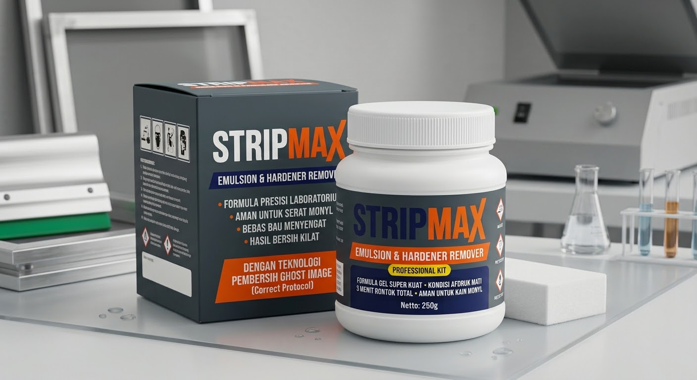

<!DOCTYPE html>
<html lang="id">
<head>
  <meta charset="UTF-8" />
  <meta name="viewport" content="width=device-width, initial-scale=1.0" />
  <title>STRIPMAX - Penghapus Emulsi Sablon</title>
  
</head>
<body>
  

    PROMO KHUSUS BENGKEL SABLON — BISA COD BAYAR DI TEMPAT!
  

  

    
STRIPMAX • EMULSION REMOVER

    <h1>Rontokkan Obat Afdruk Membandel Dalam Hitungan Menit Tanpa Merusak Mesh!</h1>
    

      Formula pasta pekat khusus tukang sablon. Oles, diamkan sebentar, semprot air — screen langsung bersih siap afdruk ulang.
    

    

      
      

        Pasta pekat siap pakai — hemat pemakaian untuk kebutuhan harian bengkel sablon
      

    

    <a
      id="directWaBtn"
      class="btn-wa"
      href="https://wa.me/6282245800129?text=Halo%20Admin%20Stripmax%2C%20saya%20mau%20tanya%20%26%20pesan%20Penghapus%20Emulsi%20Sablon%20Stripmax."
      target="_blank"
      rel="noopener"
    >
      AMBIL PROMO &amp; PESAN VIA WHATSAPP &rarr;
    </a>

    <h2 class="section-title">Kenapa Banyak Tukang Sablon Pakai Stripmax?</h2>
    <ul class="benefits">
      <li><strong>Tekstur pasta pekat</strong> — tidak gampang meleleh sebelum sempat bekerja di screen.</li>
      <li><strong>Cepat melunakkan afdruk</strong> — bantu hemat waktu bersihkan screen saat kejar order.</li>
      <li><strong>Aman untuk kain/mesh</strong> — tidak bikin kain cepat rapuh bila dipakai sesuai takaran.</li>
      <li><strong>Bisa COD</strong> — cek barang saat sampai (sesuai jangkauan kurir).</li>
    </ul>

    <h2 class="section-title">Pilih Paket Hemat</h2>
    

      

        

          
Paket Coba

          
Cocok untuk tes hasil di bengkel sendiri

        

        
Rp 35.000

      

      

        

          
Paket Bengkel

          
Paling laris untuk produksi rutin harian

        

        
Rp 60.000

      

      

        

          
Paket Juragan

          
Stok lebih banyak, harga makin hemat

        

        
Rp 105.000

      

    

    

      

        <label for="nama">Nama Anda</label>
        <input type="text" id="nama" placeholder="Contoh: Mas Adi / Bengkel Sablon Jaya" />
      

      

        <label for="paket">Paket Dipilih</label>
        <select id="paket" onchange="syncPkgFromSelect()">
          <option value="Paket Coba (Rp35.000)" selected>Paket Coba — Rp 35.000</option>
          <option value="Paket Bengkel (Rp60.000)">Paket Bengkel — Rp 60.000</option>
          <option value="Paket Juragan (Rp105.000)">Paket Juragan — Rp 105.000</option>
        </select>
      

      

        <label for="kota">Kota / Kecamatan Tujuan</label>
        <input type="text" id="kota" placeholder="Contoh: Bojonegoro / Madiun" />
      

      <button type="button" class="btn-wa" onclick="kirimWA()">
        KIRIM ORDER KE WHATSAPP SEKARANG &rarr;
      </button>
    

  

  

    

      
Harga Promo Mulai

      
Rp 35.000

    

    <a
      class="sticky-btn"
      href="https://wa.me/6282245800129?text=Halo%20Admin%20Stripmax%2C%20saya%20mau%20pesan%20Penghapus%20Emulsi%20Sablon%20Stripmax."
      target="_blank"
      rel="noopener"
    >
      Pesan Sekarang &rarr;
    </a>
  

  
</body>
</html>
